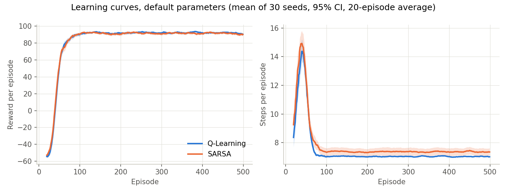
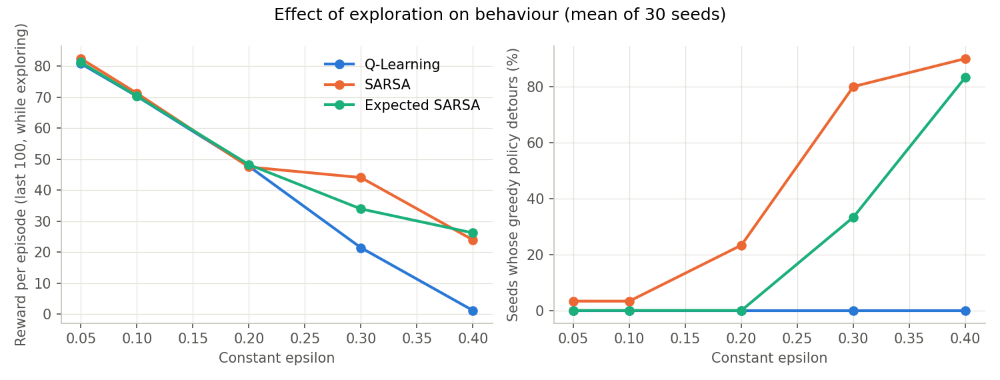
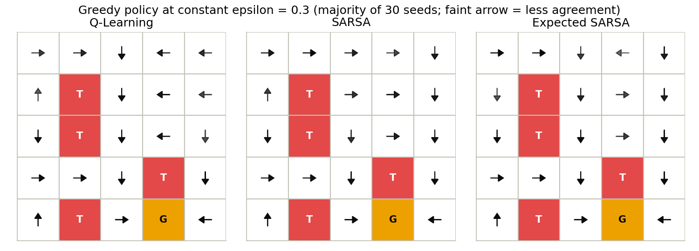
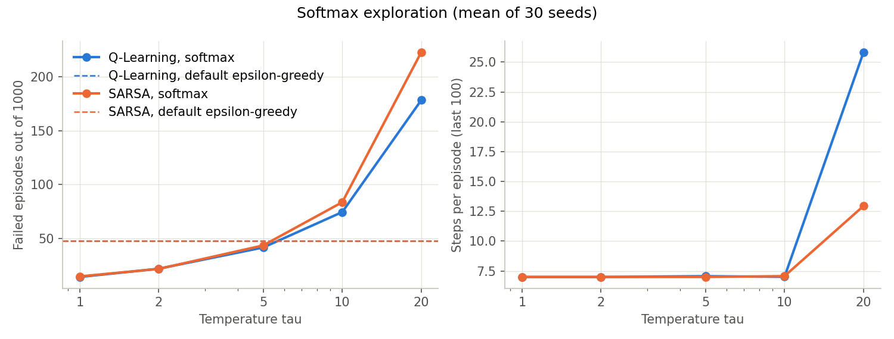

# 强化学习迷宫导航作业报告

## 1. 实现内容

- **必做**：完成 `q_learning.py` 和 `sarsa.py` 中的 `learn()`。
- **扩展**（`experiments.py`，未改动 `environment.py` 和 `train.py`）：
  - 固定 ε 对比实验
  - Expected SARSA
  - Softmax（Boltzmann）探索策略

实现时有两点需要注意：

- **SARSA 的终止状态**：`train.py` 在回合结束时传入 `next_action=None`。如果直接写 `Q[s'][None]`，numpy 不会报错，而是返回整个数组，所以必须单独判断，令终止状态的价值为 0。
- **Q-Learning 的终止状态**：`train.py` 在终止状态也会传入非空的合法动作列表，因此框架里的 `else` 分支实际走不到。但智能体到达终止状态后回合立即结束，这些状态的 Q 值不会被更新，始终为 0，所以目标值仍然正确地退化为 r。

**正确性验证**：

- 默认参数下，Q-Learning 学到的 max Q(起点, a) 平均为 **68.21**，与 7 步最短路径的理论值 −Σ₍ₖ₌₀..₅₎0.95ᵏ + 100×0.95⁶ = 68.21 一致。
- 手工算例验证了两种更新公式。
- `experiments.py` 的训练循环与 `train.py` 在相同种子下逐回合结果一致。

## 2. 实验设置

- 除特别说明外，所有结果都是 30 个随机种子的平均值，± 表示 95% 置信区间。
- **训练奖励 / 训练成功率**：最后 100 回合的平均值，此时智能体仍在按探索策略行动。
- **贪心路线**：训练结束后按贪心策略走一次（环境是确定性的，走一次即可）。这张迷宫有两条 7 步最短路线（沿上方走或沿左侧走，都紧贴陷阱），记为“最短”；超过 7 步的记为“绕行”，通常是沿右侧走的 9 步路线。
- 复现方法：`python experiments.py`。

## 3. 默认参数：学习曲线与成功率

| 算法（500 回合） | 训练奖励 | 训练成功率 | 训练步数 | 贪心测试成功 | 最短 / 绕行 |
|---|---|---|---|---|---|
| Q-Learning | 91.7 ± 0.5 | 98.5% | 7.0 | 30/30 | 30 / 0 |
| SARSA | 91.2 ± 0.6 | 98.4% | 7.4 | 30/30 | 25 / 5 |

两种算法都在约 100 回合内收敛，奖励几乎没有差别。

原因在框架的 ε 衰减方式：衰减写在 `learn()` 里，是**每步**衰减而不是每回合衰减，ε 平均在第 93～100 回合就降到了下限 0.01。此后探索极少，SARSA 评估的策略已经接近贪心策略，也就接近 Q-Learning 的目标。所以默认参数下，“SARSA 更保守”很难从奖励上看出来，只在步数和少数绕行的种子上留下一点痕迹。

## 4. 行为差异：固定 ε 对比

为了观察差异，把 ε 固定为不同的值，各训练 1000 回合。

| ε | 训练奖励：Q-Learning | SARSA | Expected SARSA | 绕行种子数：Q-Learning | SARSA | Expected SARSA |
|---|---|---|---|---|---|---|
| 0.05 | 80.8 ± 1.5 | 82.4 ± 1.2 | 81.2 ± 1.5 | 0 | 1 | 0 |
| 0.1 | 70.3 ± 1.9 | 71.3 ± 1.8 | 70.4 ± 1.7 | 0 | 1 | 0 |
| 0.2 | 47.7 ± 2.1 | 47.5 ± 3.7 | 48.2 ± 1.9 | 0 | 7 | 0 |
| 0.3 | 21.4 ± 2.5 | **44.1 ± 4.3** | 33.9 ± 4.4 | 0 | **24** | 10 |
| 0.4 | 1.2 ± 2.8 | 23.9 ± 4.5 | 26.2 ± 3.9 | 0 | 27 | 25 |

**观察与解释**：

- **Q-Learning 的目标不受探索影响**。它学习的是最优策略的价值，任何 ε 下贪心路线都是 7 步最短路线。但路线紧贴陷阱，训练时随机探索一步就可能踩中，所以 ε 越大，训练奖励下降越多。
- **SARSA 把探索的风险算进了价值**。它评估的是实际执行的 ε-贪心策略，紧贴陷阱的格子（如两侧都是陷阱的 (1,2)）价值会被拉低。ε=0.3 时 30 个种子中有 24 个改走绕行路线，多走 2 步，但训练成功率从 52.0% 升到 68.9%，训练奖励约为 Q-Learning 的两倍。这和教材中的 Cliff Walking 现象一致。
- **差异在 ε 较大时才明显**。ε≤0.2 时三种算法的奖励在置信区间内基本相同，ε=0.3 才明显分开。
- **Expected SARSA 介于两者之间**。它用下一状态 Q 值在策略下的期望作为目标，ε=0 时等于 Q-Learning。ε=0.3 时，它的奖励和绕行数都落在两者之间；ε=0.4 时已接近 SARSA。本实验的置信区间宽度与 SARSA 相近，没有观察到教材所说的方差降低，这一点不能下结论。

**结论**：如果关心部署后的贪心表现，Q-Learning 的路线更短；如果训练过程本身的失败有代价，SARSA 更稳妥。

**一个没有解释清楚的现象**：SARSA 在 ε=0.2 和 ε=0.4 时分别有 1 个和 2 个种子的贪心测试未到达目标，其他情况都能到达。我推测与固定学习率带来的 Q 值波动有关，但没有逐一排查，这只是猜测。

## 5. 探索策略：Softmax

按 P(a) ∝ exp(Q(s,a)/τ) 选择动作，τ 固定不衰减，训练 1000 回合。

| 探索策略 | 训练奖励：Q-Learning | SARSA | 累计失败回合：Q-Learning | SARSA |
|---|---|---|---|---|
| 默认 ε-贪心 | 92.2 ± 0.6 | 91.6 ± 0.6 | 47.5 | 47.6 |
| τ=1 | 94.0 ± 0.0 | 94.0 ± 0.0 | 14.3 | 14.8 |
| τ=2 | 94.0 ± 0.0 | 94.0 ± 0.0 | 22.0 | 21.8 |
| τ=5 | 93.9 ± 0.1 | 94.0 ± 0.0 | 41.7 | 43.6 |
| τ=10 | 94.0 ± 0.0 | 93.9 ± 0.1 | 74.5 | 83.7 |
| τ=20 | 70.4 ± 1.8 | 81.9 ± 1.7 | 178.4 | 222.9 |

（累计失败回合 = 1000 回合中未到达目标的回合数，包括踩陷阱和超过步数上限。）

**观察与解释**：

- **探索变“聪明”了**。ε-贪心探索时对所有动作一视同仁，已知会踩陷阱的动作也照选不误。Softmax 按价值分配概率，陷阱动作的 Q 值很低，几乎不会再被选中。所以 τ≤10 时最后 100 回合成功率都是 100%，奖励接近最优值 94。
- **失败回合更少**。τ≤5 时累计失败少于默认 ε-贪心，τ=1 时约为其三分之一。
- **两种算法的差异几乎消失**。τ≤10 时 Q-Learning 和 SARSA 的表现基本一样。这也从另一面印证了第 4 节：SARSA 绕行是因为探索会踩陷阱，探索不再踩陷阱，也就没有绕行的必要。
- **τ 不是越大越好，也不能通用**。τ=20 时 Q 值差异相对 τ 太小，智能体开始四处徘徊，Q-Learning 的平均步数升到 25.8。τ 的合适范围取决于奖励的数值大小，换一套奖励尺度就要重新调，这是 Softmax 相比 ε-贪心的缺点。

## 6. 框架中发现的小问题

这些问题没有修改，因为 README 说明 `train.py` 无需修改。

- `test_agent` 打印的 “Reached target in N steps” 多算 1 步（实际 7 步时显示 8 步）。它的平均步数统计不受此影响，但分子把失败回合的步数也算了进去，有失败回合时会偏大。
- ε 按步衰减，迷宫规模或回合长度会影响探索持续多久，这一点从 README 里看不出来。

## 7. 局限

- 所有结论都来自这一张 5×5 迷宫和固定的学习率 α=0.1，不一定能推广到其他环境。
- Softmax 实验只比较了固定 τ，没有和衰减的 τ 做比较。
- 绕行比例依赖种子数量，30 个种子只能给出大致比例。

## 8. 心得体会

> 下面是根据实验写的草稿，提交前请改成自己的真实感受。

- 一开始我以为实现了算法、跑一次对比就能看到“Q-Learning 冒险、SARSA 保守”。实际在默认参数下两条曲线几乎重合，查了之后才发现是 ε 衰减太快。这让我意识到，超参数可能会掩盖算法之间的本质差异。
- 代码虽然只有几行，但细节容易出错。`Q[s'][None]` 在 numpy 里不会报错，却完全不是想要的结果，这种错误只靠看程序能不能运行是发现不了的。用理论值 68.21 来核对学到的 Q 值，比只看成功率 100% 更让人放心。
- 单次运行不足以支撑结论。比如 Q-Learning 和 SARSA 选择哪条路线，不同种子的结果并不一样，多种子平均后才能看出规律。
